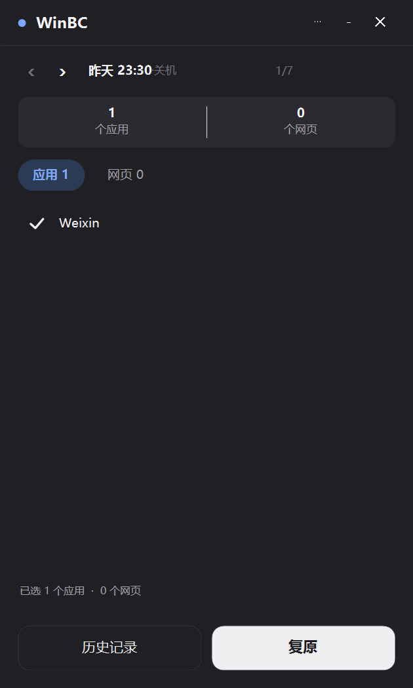
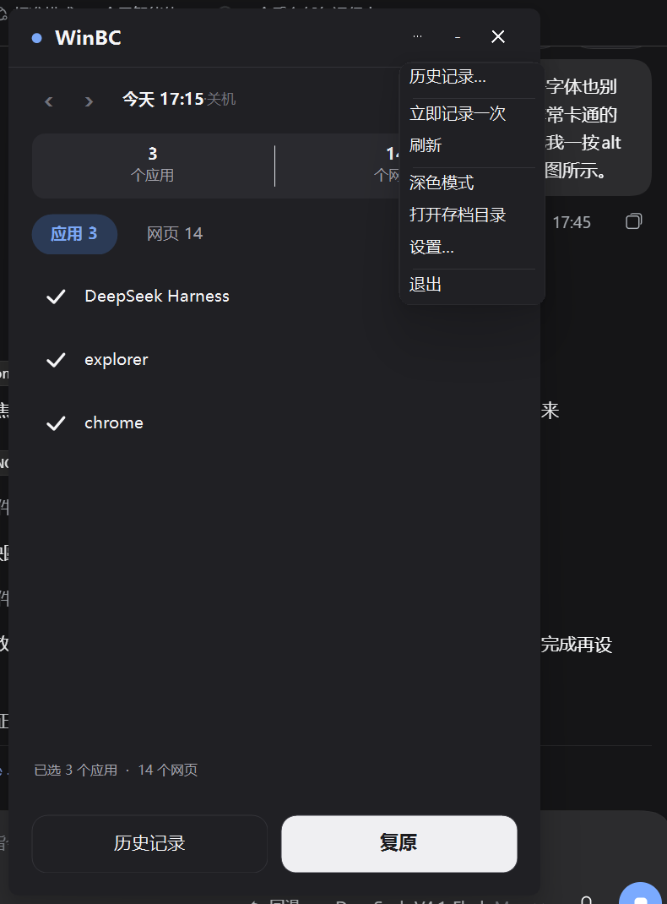
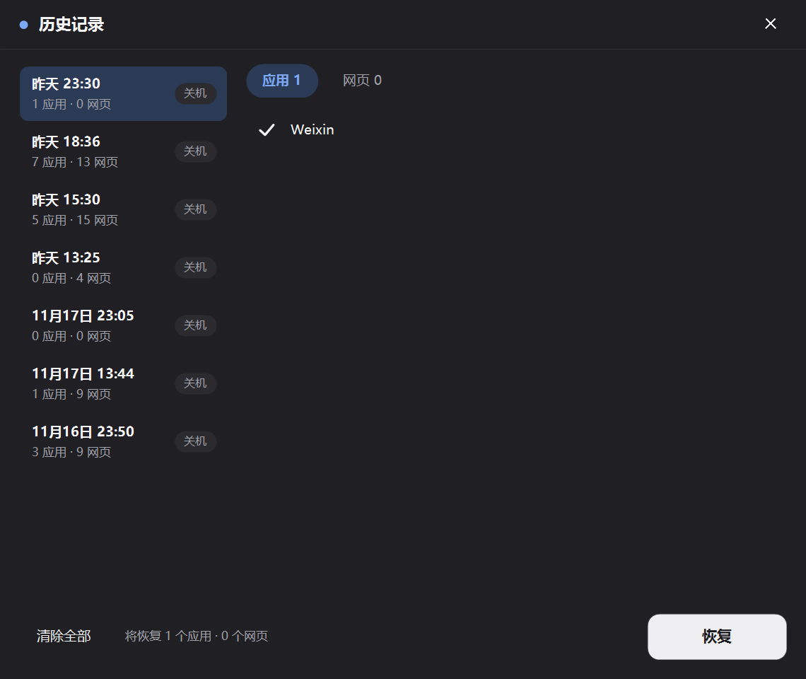
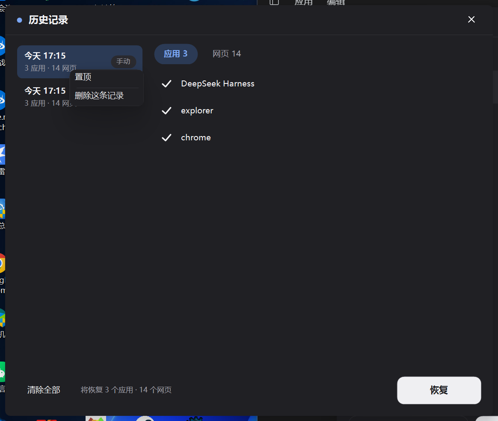
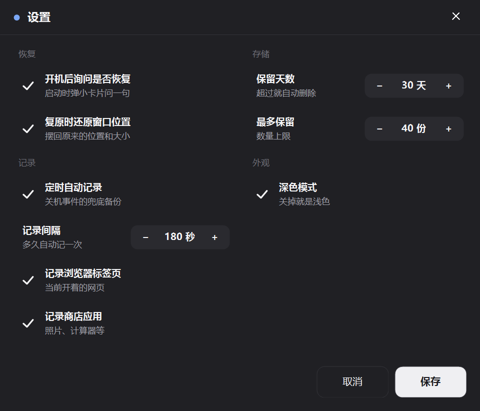

# WinBC

**关机前自动记住你桌面上开着的一切，下次开机点一下就全回来。**

重启电脑、装系统更新、不小心关机 —— 之后又得重新打开十几个软件、翻回几十个网页、把视频拖回刚才看到的地方。

WinBC 把这件事变成了自动的：它在关机那一刻拍一张「桌面快照」，下次开机弹一个小卡片问你要不要恢复。



> Windows 10 / 11 x64 · .NET 10 · 单文件 exe（约 0.3 MB）· 无第三方依赖

---

## 亮点

### 不用你手动保存

不需要提前点「保存工作区」、不用给场景起名字。**关机、重启、注销的那一刻自动记录**，你什么都不用做。

没赶上关机事件也不要紧 —— 后台每 3 分钟还有一份滚动快照兜底，最多只落后几分钟。

### 软件和网页一起记

大多数工具只能管一头：要么记应用窗口，要么管浏览器标签。WinBC 把两者当同一份状态记录、一起恢复。

- 应用：exe 路径 + 命令行参数 + 窗口矩形 + 最大化状态 + 屏幕归属
- 网页：Chrome / Edge / Brave / Vivaldi / Opera 的**真实当前标签**（直接解析 Chromium 的会话文件，不是猜历史记录）
- 视频：本地播放器的播放进度、网页视频的地址

### 窗口摆回原位

记的是 `WINDOWPLACEMENT` 而不是简单坐标，所以最大化、最小化、双屏归属都能还原。换了分辨率或拔掉副屏时，窗口会被挪回主屏中央，不会丢到看不见的地方。

### 只恢复你想恢复的

每条都能单独勾掉。系统壳窗口、输入法、驱动浮层会自动标成「跳过」且默认不勾。

### 后台几乎不存在

收起进托盘后 **≈ 9 MB 内存、0% CPU**（下面有详细数据和解释）。

---

## 从下载到使用

### 1. 装好 .NET（只需一次）

需要 [.NET SDK 10](https://dotnet.microsoft.com/download)（只编译需要，运行只要 Desktop Runtime）。

```powershell
dotnet --version   # 确认 >= 10.0
```

### 2. 下载并构建

```powershell
git clone https://github.com/zit0ng/winbc.git
cd winbc
.\build.ps1
```

产物是 `publish\WinBC.exe`，单文件、约 0.3 MB。

> 想给它自带运行时、换台机器也能直接跑：`.\build.ps1 -SelfContained`（约 150 MB）

### 3. 安装

```powershell
.\install.ps1
```

它会做三件事，**全部在当前用户范围内，不需要管理员权限**：

- 把 exe 复制到 `%LOCALAPPDATA%\WinBC\bin`
- 写一条开机自启（`HKCU\...\Run` → `--tray`）
- 注册一个「关机瞬间采集」的计划任务（事件 1074 / 6006）

### 4. 它开始自己工作了

装完托盘就有一个图标，右下角能看到。右键是这样：



平时完全不用管它。你可以随时手动拍一张：

- 托盘右键 →「立即记录一次」
- 或者主窗口 `⋯` →「立即记录一次」

### 5. 下次开机

如果发现 3 天内的关机记录，启动后会弹一张小卡片：


- **复原** —— 按快照把软件、窗口、网页全摆回来（Enter 也行）
- **稍后再看** —— 关掉，自己从托盘打开主窗口慢慢挑（Esc 也行）

### 6. 翻历史和调设置

主窗口 `⋯` →「历史记录…」，或者托盘右键。左边选时间点，右边逐条勾：



在一条记录上**右键**可以「置顶」或「删除这条记录」，左下角「清除全部」一次清空：



设置窗口两列一屏，不用滚：



| 分组 | 项 |
|---|---|
| **恢复** | 开机后询问是否恢复 · 复原时还原窗口位置 |
| **记录** | 定时自动记录 · 记录间隔（15–3600 秒）· 记录浏览器标签页 · 记录商店应用 |
| **存储** | 保留天数（默认 30 天）· 最多保留（默认 40 份） |
| **外观** | 深色模式 |

历史记录默认**保留 30 天**，超期自动删；天数可以在设置里改（1–3650）。

### 7. 卸载

```powershell
.\uninstall.ps1              # 保留快照数据
.\uninstall.ps1 -RemoveData  # 连快照一起删
```

---

## 资源占用

这是个后台常驻的辅助工具，设计目标就是「用户不找它的时候它等于不存在」。

实测（Windows 11，任务管理器口径）：

| 状态 | 工作集 | CPU |
|---|---|---|
| 窗口打开着 | ~56 MB | 0% |
| **收起进托盘后** | **≈ 9 MB** | **0%** |

### 为什么能这么低

**① 用系统给后台任务准备的正规开关**

窗口一收进托盘就调 `SetPriorityClass(PROCESS_MODE_BACKGROUND_BEGIN)` —— CPU 和磁盘 IO 优先级同时降到最低，内存页也优先被操作系统换出。重新打开窗口时 `BACKGROUND_END` 恢复，界面照样跟手。

**② 主动把工作集还给系统**

调 `SetProcessWorkingSetSize(-1, -1)` 让系统立刻回收不常用的页。这一条把 56 MB 直接砍到 9 MB，是最有效的一招。

**③ 用户不在就不采集**

每轮采集前先查 `GetLastInputInfo`。**2 分钟没碰键鼠就跳过这轮** —— 没人用的电脑桌面不会变，没必要反复扫窗口。

**④ 桌面没变就不写盘**

算一个指纹（进程 + 标题 + 窗口矩形 + 状态 + 标签数），和上一轮一样就跳过落盘，省掉每轮的磁盘写入。

**⑤ 采集本身很轻**

一次完整采集实测 **41–100 ms**（枚举窗口 + 读命令行 + 解析浏览器会话），默认 3 分钟一次 —— 折合 **0.05% CPU**。

---

## 支持范围

**浏览器标签页**

| 浏览器 | 实现方式 |
|---|---|
| Chrome / Edge / Brave / Vivaldi / Opera | 直接解析 `Sessions\Session_*` 的 **SNSS 二进制格式** |
| ↑ 补充 | 浏览器运行时独占会话文件，读不到最新数据；此时从它自己的 `History` 数据库补最近 30 分钟访问过的页面 |
| Firefox | 解析 `sessionstore-backups\recovery.jsonlz4`（mozLz4） |

**视频**：VLC（`--start-time`）、PotPlayer（`/seek`）、mpv（`--start`）、MPC-HC/BE（`/start`）

**商店应用（UWP）**：通过 `SHGetPropertyStoreForWindow` 读 `AppUserModelID`，恢复时用 `explorer.exe shell:AppsFolder\{AUMID}` 拉起

---

## 已知限制

1. **应用内部没保存的内容拿不回来** —— 记事本里没存的字、IDE 没存的缓冲、PS 没存的图层。那些只存在于内存里，任何"关机后再开机"的方案都拿不回（那是休眠文件的领域）。WinBC 复原的是「哪些程序开着、窗口在哪、在看什么」。
2. **网页视频进度只能恢复到页面**，精确到秒需要浏览器插件配合。
3. **以管理员身份运行的程序**，普通权限读不到它的命令行，会降级成只按窗口标题恢复。
4. **单实例应用**（微信、QQ、Spotify）本来就只允许一个窗口，复原时是「唤醒已有窗口」而不是新开。
5. **浏览器开着时会话文件被独占**，标签可能滞后。新开的通常能被历史补上，偶尔会多一两条已经关掉的 —— 恢复前勾掉即可。
6. 计划任务那条保险在部分机器上不会触发（关机流程中任务计划服务先停了），主力是常驻程序监听的 `SessionEnding` 和滚动快照。

---

## 命令行

| 命令 | 作用 |
|---|---|
| `WinBC.exe` | 打开主窗口（关机前复原） |
| `WinBC.exe --history` | 打开历史记录窗口 |
| `WinBC.exe --settings` | 打开设置 |
| `WinBC.exe --tray` | 静默常驻托盘（开机自启用的就是这个） |
| `WinBC.exe --snapshot [shutdown\|logoff\|manually]` | 立即采集一次并退出 |
| `WinBC.exe --restore-last` | 直接复原最近一份快照并退出 |
| `WinBC.exe --prompt` | 弹「是否复原」对话框 |

## 数据位置

```
%LOCALAPPDATA%\WinBC\
├─ snapshots\  20261116_235013_shutdown.json   每份快照 14~16 KB
│              _rolling.json                   滚动快照（不进列表）
│              _pins.json                      置顶记录
├─ logs\       winbc-YYYYMMDD.log
└─ settings.json
```

---

## 技术实现

| 层 | 关键点 |
|---|---|
| **窗口采集** | `EnumWindows` + `DwmGetWindowAttribute(DWMWA_CLOAKED)` 排除隐藏窗口；`GetWindowPlacement` 记录位置与最大化状态；`UWMA` 拆商店应用外壳 |
| **命令行** | 读目标进程 PEB（`NtQueryInformationProcess` → `ProcessParameters` → `ReadProcessMemory`），比 WMI 快两个数量级 |
| **浏览器会话** | 逐字节逆出 Chromium SNSS 格式；标题长度是**字符数不是字节数**，URL 后还要 4 字节对齐 |
| **窗口外观** | 无边框 + `WM_NCCALCSIZE` 清零非客户区 + `WM_NCACTIVATE` 拦截系统重绘，圆角交给 DWM |
| **缩放** | 全部尺寸走统一的 `S()`，`AutoScaleMode = None`（避免和 WinForms 自动缩放叠加） |

代码约 6600 行 C#，零 NuGet 依赖。

## 目录结构

```
winbc\
├─ build.ps1 / install.ps1 / uninstall.ps1
├─ docs\screenshots\
├─ src\WinBC\
│  ├─ Capture\     窗口、浏览器、媒体、UWP 采集
│  ├─ Restore\     重放：起程序 → 等窗口 → 摆位置 → 开标签
│  ├─ Storage\     快照读写、置顶、按天/按量清理
│  ├─ Triggers\    关机事件 + 定时滚动采集
│  ├─ UI\          自绘控件 + 三个窗口
│  ├─ Native\      P/Invoke
│  └─ Util\        图标、日志、单实例、资源调优
└─ tools\
   ├─ capture-test\   采集/复原的端到端自测
   └─ snss-probe\     SNSS 会话格式的逆向与验证脚本
```

---

## 许可

[MIT](LICENSE)
